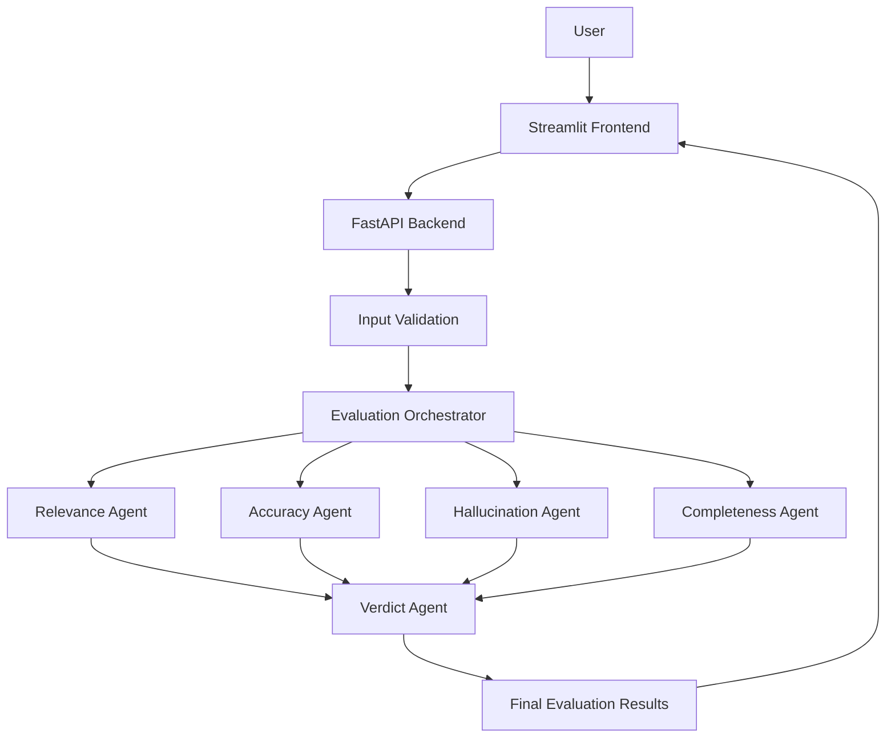
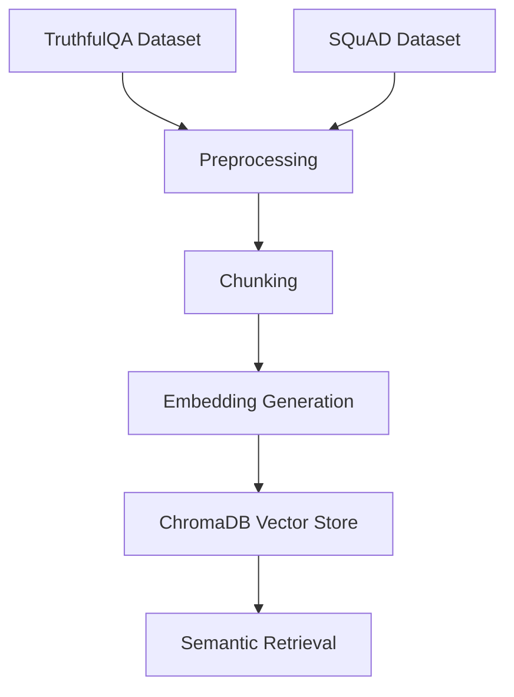

AI Response Evaluation System

System Architecture Document

1. Project Overview

The AI Response Evaluation System evaluates AI-generated answers based on relevance, accuracy, hallucination indicators, and completeness.

It accepts a question, an AI-generated response, and optional reference information. Multiple evaluation agents process the input and generate individual scores, an overall score, and a final verdict.

The project also includes a separate knowledge-base pipeline using TruthfulQA and SQuAD datasets for semantic retrieval experiments.

2. Project Objectives

- Evaluate AI-generated responses.
- Measure relevance, accuracy, and completeness.
- Estimate unsupported information using available reference evidence.
- Generate individual evaluation scores.
- Calculate an overall score and verdict.
- Develop a reference knowledge base.
- Explore RAG and semantic retrieval.

3. High-Level System Architecture

The main evaluation workflow consists of a frontend, backend, orchestrator, evaluation agents, and verdict generation.

#### 3.1 Main Evaluation Architecture

#### 3.2 Knowledge-Base Architecture

The knowledge-base pipeline is separate from the currently implemented evaluation workflow. Its execution and integration must be verified.

4. System Components

4.1 Frontend

Technology: Streamlit

Responsibilities:

- Accept user questions.
- Accept AI-generated responses.
- Accept optional reference answers.
- Accept optional source information.
- Display evaluation results.

4.2 Backend

Technology: FastAPI

Responsibilities:

- Receive frontend requests.
- Validate input using Pydantic.
- Call the evaluation orchestrator.
- Return evaluation results in JSON format.

4.3 Evaluation Agents

The system contains five agents.

Agent| Responsibility
Relevance Agent| Measures keyword overlap between the question and response.
Accuracy Agent| Compares the response with the reference answer.
Hallucination Agent| Estimates evidence-word overlap.
Completeness Agent| Estimates completeness using response length.
Verdict Agent| Calculates the overall score and generates the verdict.

4.4 Agent Details

Relevance Agent

- Receives the question and AI response.
- Extracts words from both.
- Measures keyword overlap.
- Produces a score out of 10.

Accuracy Agent

- Compares the AI response with an optional reference answer.
- Produces a basic word-overlap score.
- Returns an unavailable score when no reference answer is provided.

Hallucination Agent

- Uses the supplied reference answer or source.
- Estimates overlap between the response and available evidence.
- Returns an unavailable score when evidence is not provided.

Note: This is a basic estimate, not definitive hallucination detection.

Completeness Agent

- Checks the response.
- Uses response length to estimate completeness.
- Produces a score out of 10.

Verdict Agent

- Collects available scores.
- Excludes unavailable scores.
- Calculates the average.
- Generates the final verdict.

5. Scoring Methodology

Each applicable agent produces a score from 0 to 10.

Overall Score = Sum of Available Scores / Number of Available Scores

Unavailable scores are excluded.

| Score Range | Verdict |
|-------------|---------|
| 8 to 10 | Good |
| 5 to below 8 | Needs Improvement |
| Below 5 | Poor |
| No available scores | Insufficient Information |

The current scoring methods use basic word overlap and response length. They require further validation and improvement.

6. Orchestration Flow

1. User submits the question, AI response, and optional reference answer or source.

2. The Orchestrator sends the question to the ChromaDB Retrieval Module.

3. The Retrieval Module searches both:
   - AI Evaluation Knowledge Collection
   - Technical Reference Knowledge Collection

4. The Retrieval Module ranks results using cosine similarity and returns the top 3 relevant passages.

5. The Orchestrator passes retrieved evidence to the Accuracy and Hallucination Agents when manual evidence is not provided.

6. The Relevance Agent evaluates question-response relevance.

7. The Accuracy Agent evaluates response similarity with the available reference evidence.

8. The Hallucination Agent calculates a basic evidence-word overlap score.

9. The Completeness Agent estimates response completeness.

10. The Verdict Agent combines available scores and generates the final verdict.

11. The system displays evaluation results to the user.
12.

7. Data Models

7.1 Evaluation Input Model

The system uses Pydantic for input validation.

| Field | Data Type | Description |
|---|---|---|
| question | String | User's question |
| ai_response | String | AI-generated answer |
| reference_answer | Optional String | Reference answer for comparison |
| source | Optional String | Supporting source information |

7.2 Evaluation Output Model

The output contains:

- Original question.
- AI-generated response.
- Individual agent scores.
- Explanation for each score.
- Overall score.
- Final verdict.

8. Reference Knowledge Base

The project uses two datasets.

TruthfulQA

- A benchmark for evaluating truthful responses from language models.
- Used for studying truthfulness and model evaluation.

SQuAD

- A question-answering dataset.
- Contains questions, contexts, and answers.
- Used to build a reference collection for retrieval experiments.

8.1 Knowledge-Base Processing

1. Dataset loading.
2. Text preprocessing.
3. Text chunking.
4. Embedding generation.
5. Vector storage.
6. Semantic retrieval.

8.2 Retrieval Configuration

| Component | Configuration |
|---|---|
| Embedding Model | all-MiniLM-L6-v2 |
| Vector Database | ChromaDB |
| Chunk Size | 500 words |
| Chunk Overlap | 50 words |
| Retrieval Count | Top 3 results |

These are the configured design values; execution and validation must be confirmed.

9. Project Folder Structure

| Agent | Responsibility |
|---|---|
| Relevance Agent | Measures keyword overlap between the question and response. |
| Accuracy Agent | Compares the response with the reference answer. |
| Hallucination Agent | Estimates evidence-word overlap. |
| Completeness Agent | Estimates completeness using response length. |
| Verdict Agent | Calculates the overall score and final verdict. |
10. Current Implementation Status

| Component | Status |
|---|---|
| Streamlit Frontend | Implemented |
| FastAPI Backend | Implemented |
| Input Validation | Implemented |
| Evaluation Orchestrator | Implemented |
| Relevance Agent | Implemented |
| Accuracy Agent | Implemented |
| Hallucination Agent | Implemented as a baseline |
| Completeness Agent | Implemented |
| Verdict Agent | Implemented |
| Initial Evaluation Testing | Completed |
| Dataset Downloading | In Progress |
| Preprocessing | Code Prepared |
| Chunking | Code Prepared |
| Embedding Generation | Code Prepared |
| ChromaDB Storage | Code Prepared |
| Semantic Retrieval | Code Prepared |
| Retrieval Quality Validation | Pending |
| Retrieval Integration | Pending |
11. Limitations and Future Enhancements

Limitations

- Current evaluation uses basic word-overlap and length-based methods.
- Accuracy scores do not prove factual correctness.
- Hallucination scores do not definitively identify false claims.
- Knowledge-base execution and integration require verification.
- RAGAS and TruLens have been studied but are not integrated.

Future Enhancements

- Introduce semantic similarity-based evaluation.
- Improve factual accuracy verification.
- Integrate retrieved evidence into evaluation.
- Improve hallucination detection.
- Validate retrieval quality.
- Explore RAGAS and TruLens integration.

12. Conclusion

The AI Response Evaluation System provides a modular baseline for evaluating AI-generated responses. The frontend, backend, evaluation agents, and verdict-generation workflow form the initial working prototype.

The knowledge-base pipeline provides a foundation for future semantic retrieval and evidence-based evaluation.
# MILESTONE 2 – SYSTEM ARCHITECTURE AND WORKFLOW

## 1. Overview

The AI Response Evaluation System uses a multi-agent architecture to evaluate AI-generated responses based on relevance, accuracy, hallucination, and completeness.

Gemini API is used as the semantic evaluation engine, while ChromaDB provides supporting knowledge for evidence-based evaluation.

## 2. System Architecture

The system consists of the following components:

1. User Input Module
2. Knowledge Base and Retrieval Module
3. Gemini Evaluation Engine
4. Relevance Agent
5. Accuracy Agent
6. Hallucination Agent
7. Completeness Agent
8. Orchestrator
9. Weighted Scoring and Verdict Module
10. Result Display Module

## 3. Evaluation Workflow

1. The user enters a question and AI-generated response.
2. An optional reference answer or source document can be provided.
3. If reference information is not provided, the system retrieves relevant context from ChromaDB.
4. The retrieved context and input are passed to the Gemini evaluation engine.
5. Four evaluation agents assess the response.
6. Each agent generates a score, reasoning, and supporting evidence.
7. The Orchestrator collects the evaluation results.
8. The weighted scoring mechanism calculates the final score.
9. The final verdict and individual agent results are displayed through Streamlit.

## 4. Agent Responsibilities

### Relevance Agent
Evaluates whether the AI response directly addresses the given question.

### Accuracy Agent
Checks the factual correctness of the response using reference information or retrieved knowledge.

### Hallucination Agent
Identifies unsupported or fabricated claims in the AI response.

### Completeness Agent
Evaluates whether the response contains sufficient information to answer the question.

## 5. Weighted Scoring Mechanism

The final evaluation score is calculated using the following weights:

| Evaluation Agent | Weight |
|---|---:|
| Relevance | 25% |
| Accuracy | 35% |
| Hallucination | 25% |
| Completeness | 15% |

Final Score = 
(Relevance × 0.25) +
(Accuracy × 0.35) +
(Hallucination × 0.25) +
(Completeness × 0.15)

## 6. Output

The system displays:

- Individual agent scores
- Agent evaluation categories
- Reasoning for each evaluation
- Supporting evidence when available
- Overall weighted score
- Final evaluation verdict

## 7. Conclusion

The multi-agent architecture enables systematic evaluation of AI-generated responses. Gemini provides semantic evaluation, ChromaDB supports evidence retrieval, and the Orchestrator combines the results to generate an overall evaluation.